<h3><code>meer@github:~$ ./contributions.sh</code></h3>

  

<h3><code>meer@github:~$ whoami</code></h3>

<table>
<tr>
<td valign="top"></td>
<td valign="top"></td>
</tr>
</table>

 

<a href="https://meermujtaba.github.io/Portfolio-Website/">portfolio</a> ·
<a href="https://github.com/MeerMujtaba">github</a> ·
<a href="https://www.linkedin.com/in/meer-mujtaba">linkedin</a> ·
<a href="mailto:meermujtaba@gmail.com">email</a> ·
<a href="https://orcid.org/0009-0000-9827-9369">orcid</a>

<i>"I like building things that work — and learning why they don't."</i>

